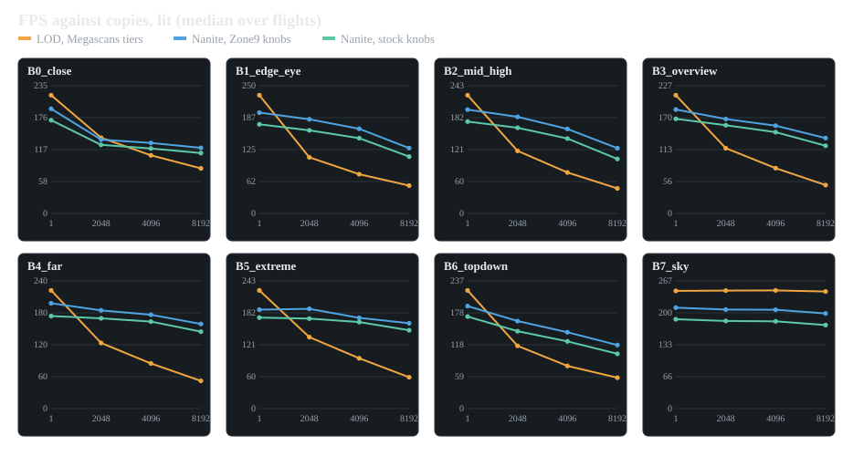

# Nanite vs LOD on a Radeon 680M handheld

A replication of [CRDG Studio's Nanite vs LOD test](https://crdg.jp/studio-tech-1/en/2025/05/29/3438/) (UE 5.5, RX 580) on **Unreal Engine 5.8.4**, measured on an **AOKZOE A1 handheld (Radeon 680M)** at 1280×800 with TAA and cascaded shadow maps.

**Report: <https://windystrife.github.io/nanite-lod-bench/>**

The Megascans *Wooden Table* (`uc1kebzfa`) is placed 1, 2048, 4096 and 8192 times as separate static mesh actors and seen from eight camera views, lit and unlit:

| Arm | Mesh | Triangles |
|---|---|---|
| **LOD** | Non-Nanite, 8 LODs from the Megascans High / Mid / Low tiers plus generated LODs in between | 21 852 · 17 482 · 14 204 · 12 236 · 7 342 · 4 894 · 3 288 · 1 644 |
| **Nanite, game settings** (Nz) | Raw scan, Nanite, `r.Nanite.MaxPixelsPerEdge=2`, `r.Nanite.Culling.TwoPass=0` | 2 000 018 (fallback 7 090) |
| **Nanite, engine defaults** (Ns) | Same mesh, `MaxPixelsPerEdge=1`, two-pass culling on | 2 000 018 |

Six flights (LOD, Nz, Ns, Ns, Nz, LOD), every arm twice; the run-to-run spread is a median 0.05 ms.

## Results at a glance



| Copies | Lit, views with tables | Nanite (game settings) against LOD |
|--:|---|--:|
| 1 | LOD 211–247 FPS, Nanite 185–212 FPS | 0.84–0.89× |
| 2048 | close view a tie, other views Nanite ahead | 0.97–1.68× |
| 4096 | Nanite ahead in every view with tables | 1.21–2.16× |
| 8192 | LOD 48–83 FPS, Nanite 118–163 FPS | 1.46–3.06× |
| 8192 unlit | | 1.43–4.49× |

- At high counts the LOD side is **render-thread bound**: its render-thread time equals the frame time (12–21 ms at 8192 copies), the per-actor CPU cost the original article found in `MeshDrawCommandPassSetupTask`.

### Instanced (one ISM component)

| 8192 copies, lit | LOD actors | LOD, ISM | **LOD aggressive, ISM** | Nanite, ISM |
|---|--:|--:|--:|--:|
| close | 83 | 91 | **160** | 128 |
| eye level | 53 | 56 | **143** | 133 |
| overview | 50 | 47 | 141 | **143** |
| far | 52 | 52 | 165 | **170** |

- ISM removes the render-thread limit (1.9–4.8 ms), but the LOD mesh then becomes GPU-bound on tiny far triangles and its FPS barely moves.
- With an aggressive chain (last LODs 494 / 198 / 98 / 64 triangles) in one ISM, LOD beats Nanite in 38 of 40 view and count combinations (up to 1.35×) and ties in the other two. That is the case impostors are made for; baked impostors are not measured. LOD popping in motion is not measured either.
- With one table, or in a view with almost nothing on screen, LOD is faster: Nanite has a fixed cost of about 1 ms of GPU time on the 680M.
- The game's Nanite settings beat the engine defaults in all 40 view and count combinations (by 0.3–29 %).

## Layout

| Path | What |
|---|---|
| `index.html`, `charts/`, `img/` | The report (GitHub Pages). |
| `data/megascans/<flight>/` | Per flight: `segments.csv` (one row per count, view and lit/unlit), `summary.json` (bench settings, mesh, cvars), `meta.json` (harness checks), `frames.csv.gz` (every frame). `report.json` and `pairs.csv` are the medians across flights. |
| `data/procedural/` | The same campaign with a procedural 249k-triangle table and article-style auto LODs, one flight per arm. |
| `bench/` | The UE 5.8 bench project: C++ game module (`UNLBBenchSubsystem` spawns the grid, drives the camera, measures and writes the results), configs, the editor Python that builds the assets, and the analysis scripts. |
| `tools/` | Site generator (`make_site.py`), data export, page text (`notes.json`). |

The Megascans asset is not redistributed; `bench/Tools/build_assets.py` imports it from the Fab download (`NLB_SRC` for the raw FBX, `NLB_MS_HIGH/MID/LOW` for the tiers).

### Rebuilding the report

```
py -I bench/Tools/analyze_nlb.py <runs dir> <out prefix>
py -I tools/make_site.py data/megascans/report.json data/procedural/report.json tools/notes.json .
```

Bench command line (see `bench/Source/NaniteLodBench/Public/NLBBenchSubsystem.h` for every option):

```
NaniteLodBench.exe -fullscreen -ResX=1280 -ResY=800 -NLBAsset=Table -NLBMode=LOD|Nanite -NLBCounts=1,2048,4096,8192 -NLBSG=0 -NLBUnlit=1 -NLBShots=1 -NLBCsv=1
```
